# Website Delivery Report: deutsches-museum.de

**CM-501 · EPA 1 · Part A** · Farida Barakat · 17 November 2026

**Site:** <https://www.deutsches-museum.de/> (home page, public, no login)

**Tools:** Lighthouse 13.6.0 through PageSpeed Insights (mobile: Moto G Power on **Slow 4G**; desktop: fast connection), plus the browser's own **Performance API**, run live on the page the same way you'd run it in the DevTools console. Unused-code numbers come from Lighthouse's coverage audits. All screenshots are in [`evidence/`](evidence/). Sizes are in KiB (1 KiB = 1,024 bytes).

---

## A1 · Page totals: normal vs. Slow 4G

| First visit (empty cache) | Desktop, fast connection | Mobile, Slow 4G | Change |
|---|---|---|---|
| Page weight (initial load) | 1,973 KiB | 1,973 KiB | same bytes |
| First Contentful Paint | 0.4 s | **2.6 s** | 6.5× slower |
| Largest Contentful Paint | 0.9 s | **2.6 s** | 2.9× slower |
| Speed Index | 0.8 s | **4.7 s** | 5.9× slower |
| Total Blocking Time | 20 ms | 240 ms | slower CPU too |

On a repeat visit the browser already has most of the page cached. Live measurements show **21 requests**, 13 of them served straight from the cache. Only **25.5 KiB** travelled over the network, even though the page actually uses 3,146.7 KiB of decoded resources. DOMContentLoaded landed at 661 ms, Load at 737 ms.

The bytes don't change between normal and Slow 4G — only the connection does. But that's enough to make the first paint more than six times slower. The upside is that caching is doing its job well: a returning visitor downloads roughly **1% of what a first-time visitor does**.

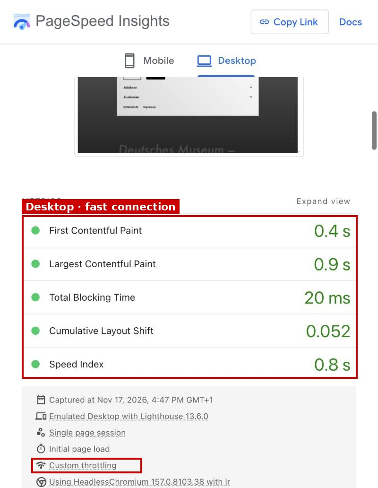 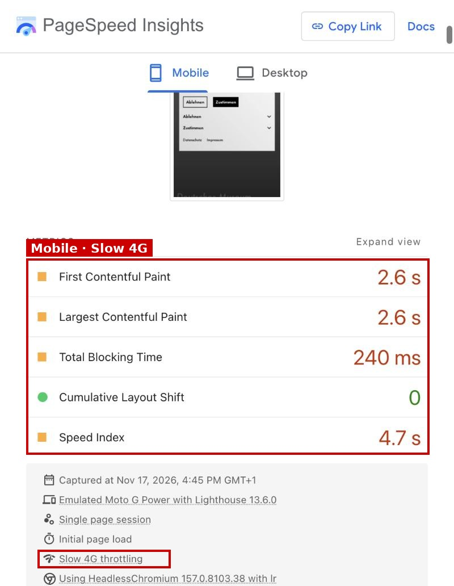 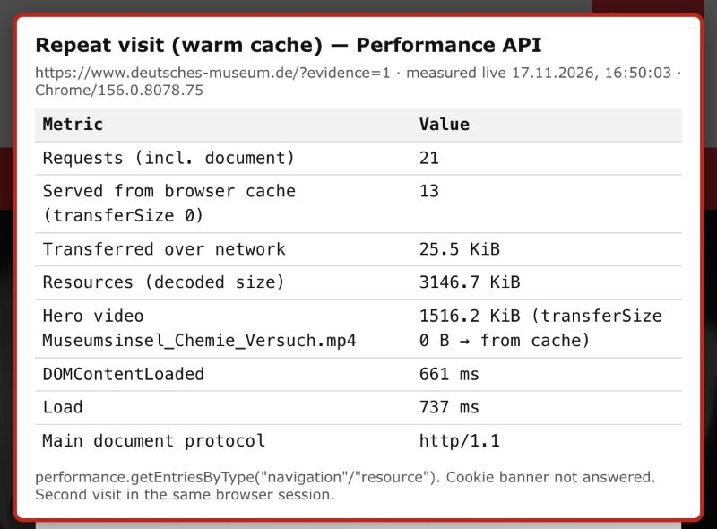

## A2 · The three largest resources (initial load)

| # | File | Type | Transfer size | Role |
|---|---|---|---|---|
| 1 | `Museumsinsel_Chemie_Versuch.mp4` | video | **1,516.6 KiB** | hero "cinemagraph", autoplays, 3.3 s loop |
| 2 | `bundle.1793289553.js` | script | 164.2 KiB | main JavaScript bundle |
| 3 | `bundle.1793289553.css` | stylesheet | 69.4 KiB | all site CSS in one file |

That one video is **77% of the entire first load** (1,516.6 of 1,973 KiB), and it downloads on mobile too, decoration included. Scroll down and a 1,456 KiB PNG joins the list as the second-largest file on the page (see A3).

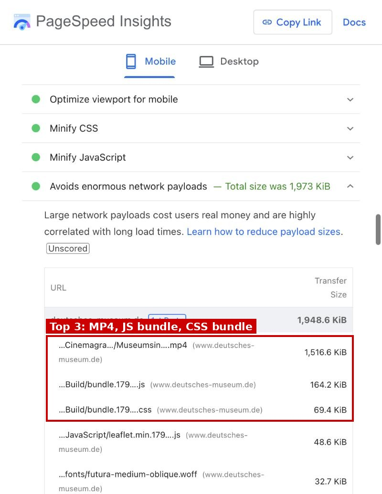

## A3 · Images

Once you scroll through the whole page, **20 content images** have loaded: **4,583 KiB** in total, 16 JPG and 4 PNG. Not a single WebP or AVIF anywhere.

A few things stand out:

- **What's working:** the images are **lazy-loaded** through `data-src`, so nothing below the fold loads up front. That's exactly why A1 only shows 1,973 KiB.
- **The wrong format:** `Ausstellung_Astronomie_Hornantenne….png` is a photograph saved as PNG — 1,456 KiB for one image. I re-encoded it right in the browser to check: as WebP it drops to **124.7 KiB (−91%)** at the same pixel size, or **80.3 KiB (−94%)** at twice the size it's actually shown at.
- **Oversized for their slot:** that same PNG is 1502×998 px but only ever shown at 534×355 px — **7.9× more pixels than needed**. Three JPGs are 1882×1059 px shown at 554×312 px (**11.5×**).
- **No dimensions set:** none of the `` elements have `width` and `height` attributes, which Lighthouse flags. That's part of why the desktop layout shift (CLS) came in at 0.052 instead of 0.

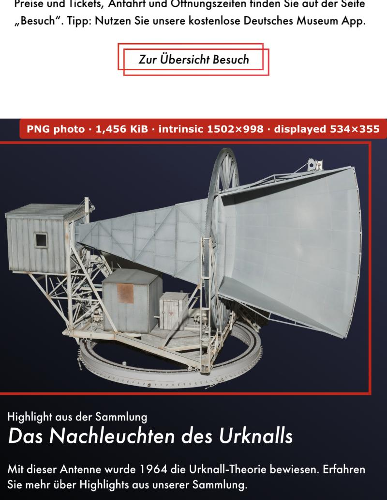 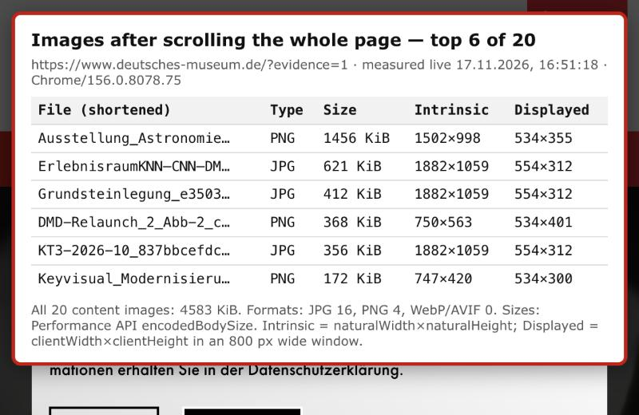 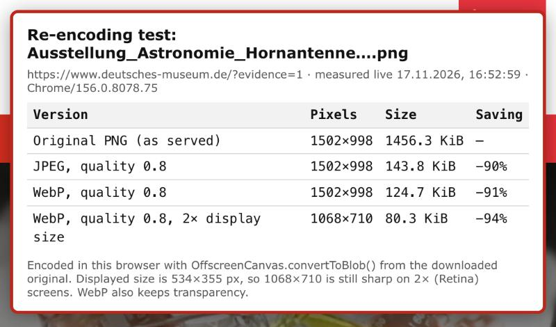

## A4 · Third parties

**None.** Before answering the cookie banner, and after clicking **Ablehnen** (reject) and scrolling the whole page, the only host contacted was `www.deutsches-museum.de` — 42 requests, all first-party. Lighthouse's own "3rd parties" audit agrees. YouTube, Instagram, Facebook and LinkedIn only show up as plain links, never as embeds, so nothing actually loads from them.

That's good news twice over: for **privacy**, since no data leaves the site for another company before consent is given (which is what GDPR asks for), and for **speed**, since there's no extra DNS lookup, TLS handshake or third-party script slowing things down. One gap worth naming: I didn't test what happens after clicking **Zustimmen** (accept) — the banner mentions analytics, so something probably loads once you agree to it.

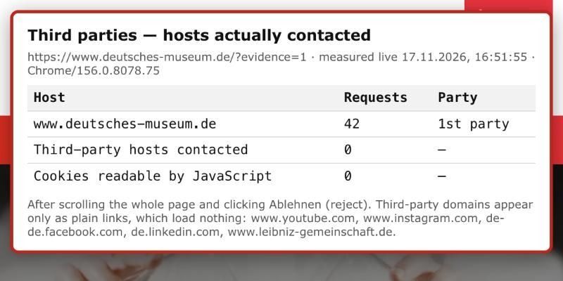 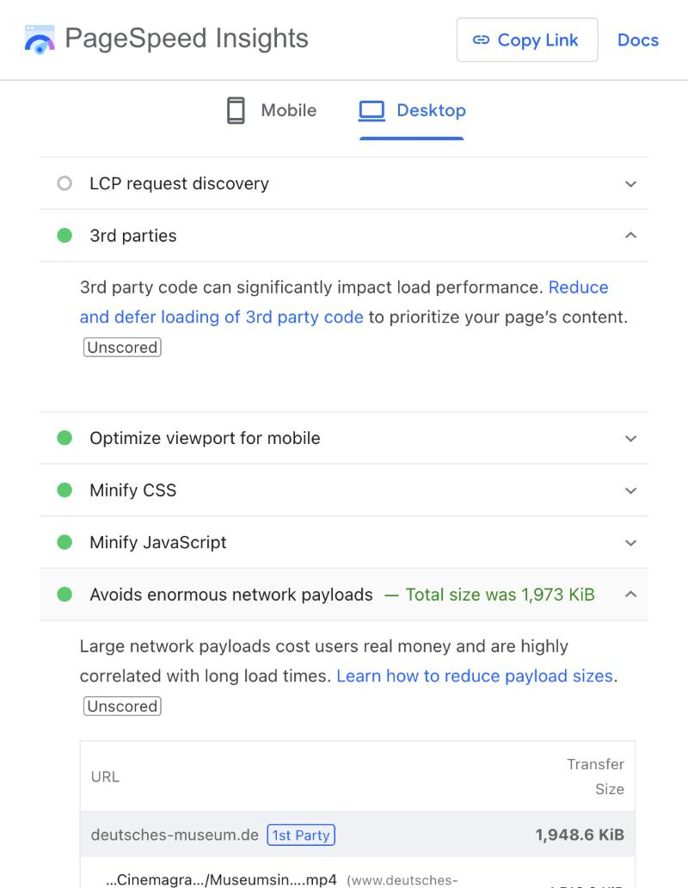

## A5 · Render-blocking and unused code

Two stylesheets sit in `<head>` and have to finish loading before anything can paint: `bundle….css` (69.4 KiB, 1,050 ms on Slow 4G) and `leaflet….css` (3.6 KiB, 150 ms). Lighthouse estimates fixing this would save **750 ms**.

A lot of what does load never gets used:

| File | Transfer | Unused | Share |
|---|---|---|---|
| `bundle….css` | 68.9 KiB | 58.4 KiB | **85%** |
| `bundle….js` | 163.7 KiB | 104.5 KiB | 64% |
| `leaflet.min….js` (map library) | 48.1 KiB | 40.1 KiB | **83%** |
| **All JavaScript** | 211.7 KiB | 144.6 KiB | **68%** |

The **Leaflet map library** loads on the home page even though no map is visible when it arrives. Its script sits in `<body>` without `defer`, so it also blocks HTML parsing along the way. On top of that, Lighthouse flags 37 KiB of **legacy JavaScript** — polyfills for browsers most visitors probably aren't using — and WOFF fonts with no `font-display` set, costing about 130 ms.

CSS blocking the first paint isn't automatically a bug — without it, visitors would briefly see unstyled content. The fix isn't to make it load async; it's to **inline the small amount of critical CSS** needed for the first screen and load the rest afterwards, and to split that one big bundle by page type instead of shipping all of it everywhere.

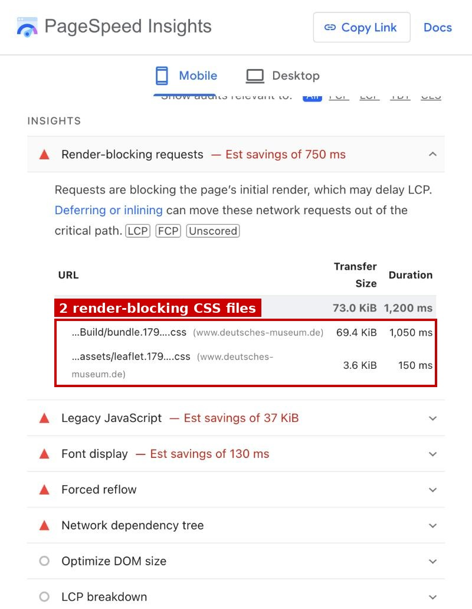 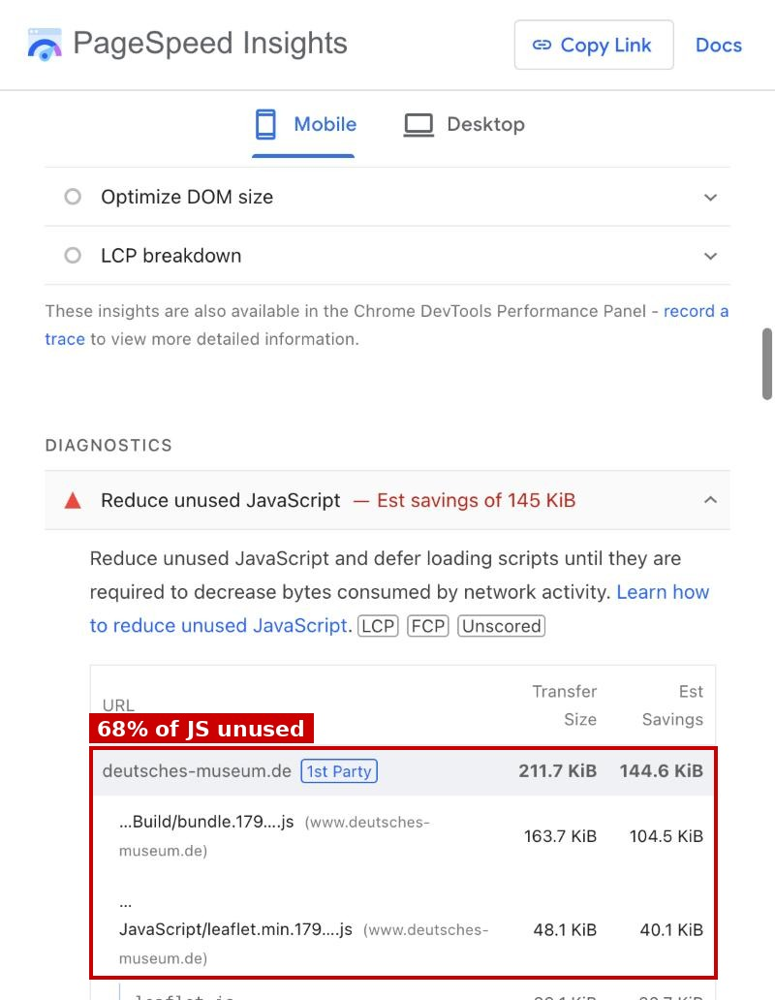 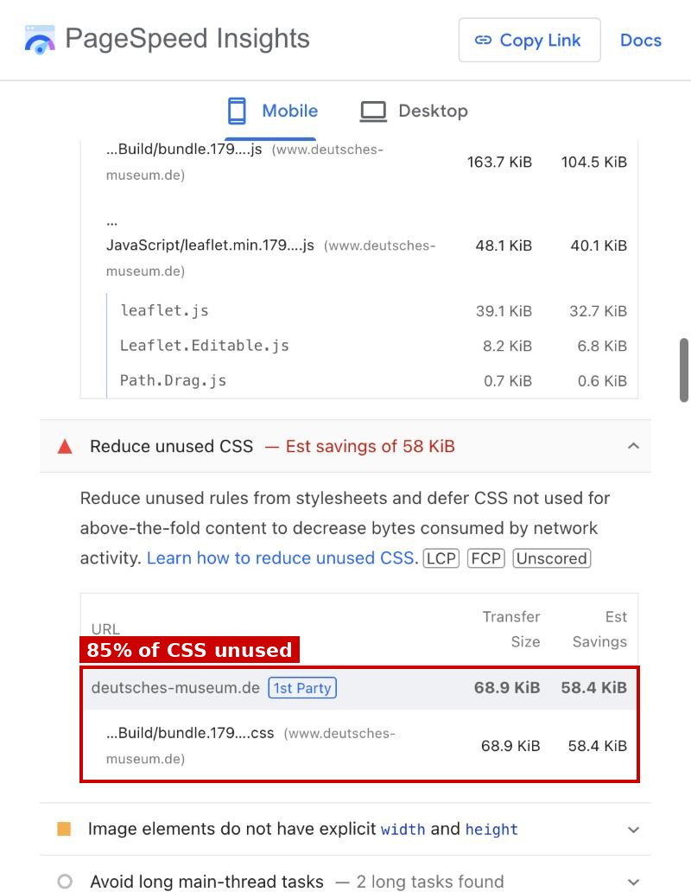

## A6 · Lighthouse (mobile)

**Performance 86** · Accessibility 91 · Best Practices 100 · SEO 92. Metrics: FCP 2.6 s · LCP 2.6 s · TBT 240 ms · CLS 0 · SI 4.7 s.

The three recommendations Lighthouse weights highest:

1. **Render-blocking requests** (est. 750 ms) — inline critical CSS, defer the rest.
2. **Reduce unused JavaScript** (est. 145 KiB) — only load Leaflet where a map actually appears, and drop the old polyfills.
3. **Reduce unused CSS** (est. 58 KiB) — split the 69 KiB bundle per page instead of one file for everything.

Interestingly, real-user field data from the Chrome UX Report *passes* Core Web Vitals outright (LCP 1.5 s, INP 91 ms, CLS 0.01) — the lab test above is closer to a worst case than to what most visitors actually experience. It's also worth knowing what Lighthouse quietly misses: it never flags the 1.5 MB video, because the page as a whole still passes the "enormous network payloads" audit, and it can't see the oversized PNG at all, since that image only loads once you scroll past it.

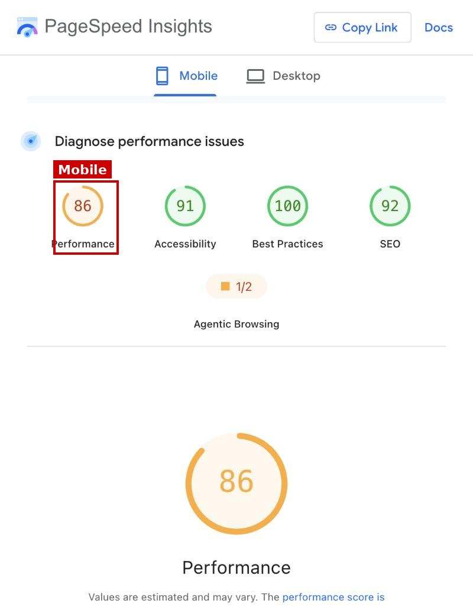 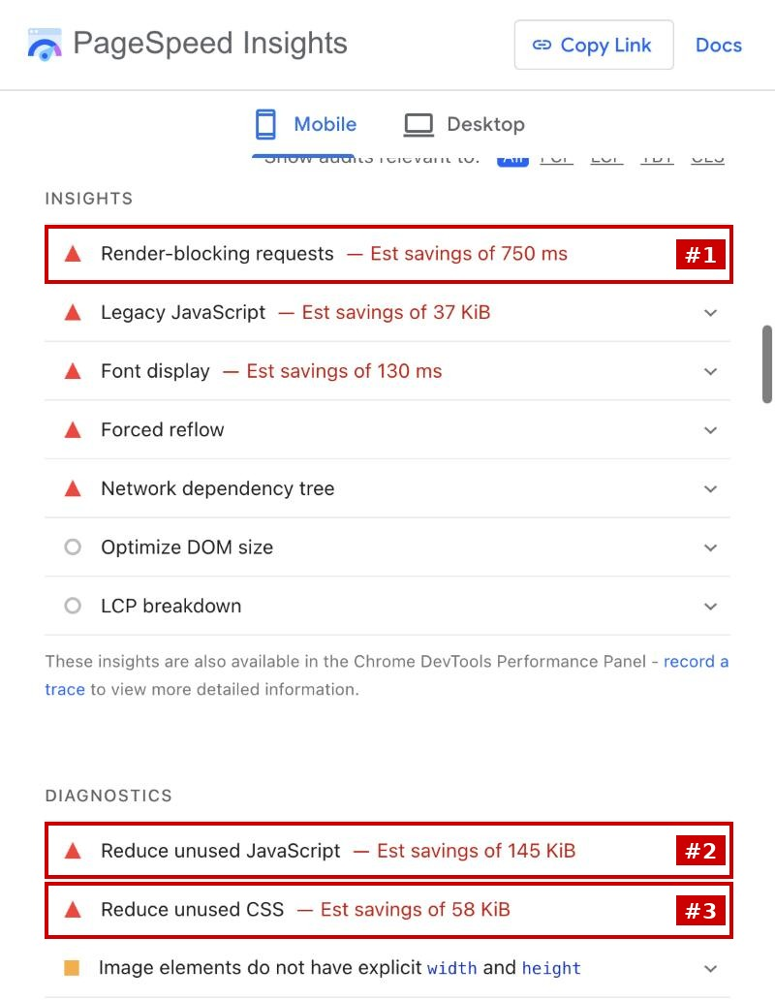 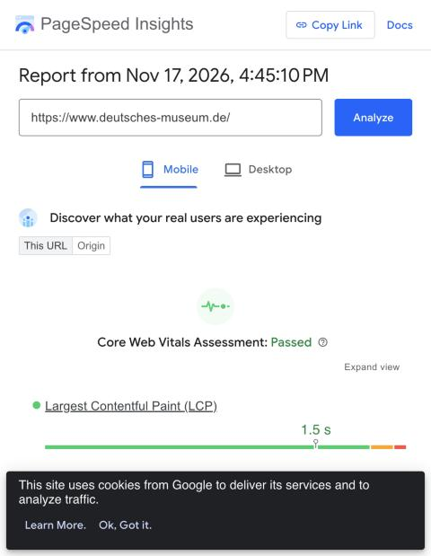

## A7 · Main document and three headers

`GET https://www.deutsches-museum.de/` returns **200 OK** over **HTTP/1.1**. The HTML is 21,564 bytes gzip-compressed, 95,296 bytes once decoded.

1. **`content-encoding: gzip`** — the HTML is compressed before it's sent, shrinking it by **77%**. Switching to Brotli (`br`) would squeeze out a little more.
2. **`strict-transport-security: max-age=63072000`** — for the next **2 years**, the browser will only ever reach this site over HTTPS, even if someone types `http://` by mistake. It's missing `includeSubDomains` and `preload`, though.
3. **`x-cache: hit cached`**, with **`age: 1307`** — a server-side cache (likely Varnish) had this page sitting ready, 1,307 seconds old at the time. A few minutes later it read `age: 1477`, so it was still serving that same cached copy. That's exactly why the field TTFB is such a quick 0.4 s. The catch: the HTML itself sends **no `cache-control`, `etag` or `last-modified`**, so the browser has nothing cheap to check against on the next visit.

The versioned asset files handle this far better. `bundle.1793289553.css` carries **`cache-control: max-age=31536000`** — a full year — and that version number in the filename changes with every release, which is exactly how **cache busting** is supposed to work. It's the reason a repeat visit only costs 25.5 KiB. One more gap on the security side: there's no `content-security-policy` and no `x-frame-options` header either.

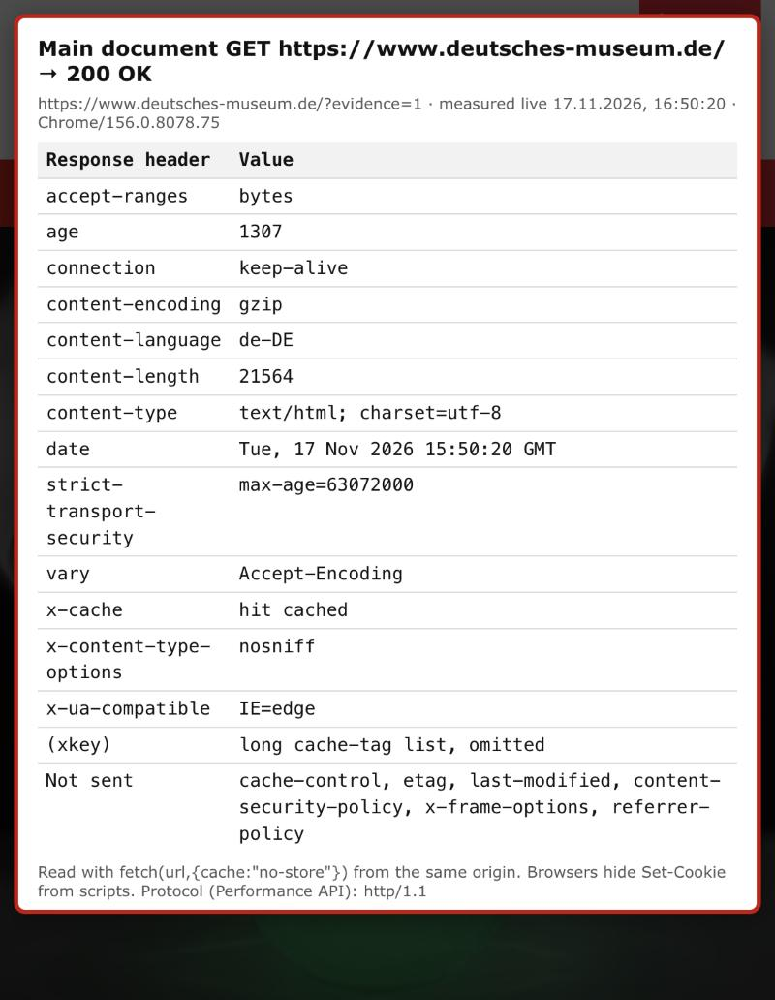 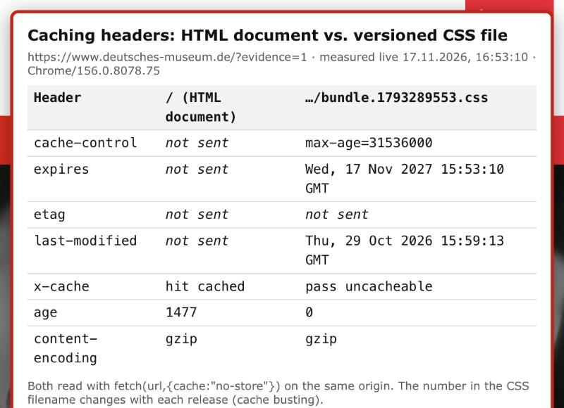

## A8 · Conclusion

The fundamentals here are solid. The site sends **no third-party requests**, compresses its HTML, runs behind a server cache, and **caches its versioned files for a full year**. Real users pass Core Web Vitals comfortably. What's actually costing performance is **media weight** and **code nobody's trimming**. In order of impact:

1. **The hero video (1.5 MB):** 77% of the first load is a 3-second decorative loop. A poster image on mobile and for anyone with `prefers-reduced-motion` set, `preload="none"`, and a smaller re-encode would all help.
2. **Images (4.5 MB once you scroll):** serve WebP or AVIF at the size they're actually displayed, with `srcset`. The one PNG I tested dropped from 1,456 KiB to 80 KiB just by changing format. Add `width` and `height` while you're at it.
3. **The render path (750 ms on Slow 4G):** inline critical CSS, split the CSS and JS bundles per page, only load Leaflet where there's a map, and add `defer` where it's missing.
4. **Smaller wins:** WOFF2 with `font-display: swap`, HTTP/2, and a `cache-control` header plus a CSP on the HTML itself.

Fixing just the video would bring the first visit on mobile data down from 1,973 KiB to well under 500 KiB. Fixing the images would make scrolling the page several megabytes lighter on top of that.
