# EPA 1 Part A · Delivery Report: Deutsches Museum

Author: Farida Wael Barakat · Site analysed: https://www.deutsches-museum.de/ (home page)
Tools: Chrome DevTools (Network, Elements, Console, Coverage, Lighthouse) in Chrome Incognito, `curl` · Measured: 21 Nov 2026

DevTools shows sizes in **kB** (1 kB = 1,000 bytes). Lighthouse uses **KiB** (1 KiB = 1,024 bytes).

## A1. Page totals: normal vs. Slow 4G

| Measure | No throttling | Slow 4G | Change |
|---|---|---|---|
| Requests | 42 | 42 | same |
| Transferred | 4.1 MB | 3.3 MB | about the same |
| Resources (unpacked) | 5.4 MB | 4.6 MB | about the same |
| DOMContentLoaded | 632 ms | **4.01 s** | **6.3× slower** |
| Load | 1.24 s | **11.80 s** | **9.5× slower** |
| Finish | 1.72 s | **21.13 s** | **12× slower** |

Repeat visit (cache **on**): 39 requests · only **31.6 kB transferred** of 4,553 kB resources · Load 715 ms.

Evidence: `a1-normal.png`, `a1-slow4g.png`, `a1-repeat-visit.png` (Disable cache on for the first two).

**Explanation:** The page sends the **same files** on both connections. Only the network changes.
On Slow 4G a visitor waits about **12 s** for the page to load and **21 s** until the last request ends.
Transferred is a bit lower on Slow 4G because the video streams in pieces (status `206`), and in that time
the browser did not fetch every piece. Caching works well: a returning visitor downloads under 1% of the page.

## A2. The three largest resources

| # | File | Type | Size (transferred) |
|---|---|---|---|
| 1 | `Museumsinsel_Chemie_Versuch.mp4` | video | **about 2,147 kB** (3 parts: 1,475 + 606 + 65.5 kB) |
| 2 | `csm_kispi_16_4bba1014d8.jpg` | image | 236 kB |
| 3 | `csm_Aktionstag_e6be388478.jpg` | image | 190 kB |

Next largest: `bundle.1794932180.js` 168 kB, `bundle.1794932180.css` 71.1 kB.

Evidence: `a2-largest.png` (sorted by Size, 3.9 MB transferred in that load).

**Explanation:** The hero video appears **three times**, but it is one file. Status `206 Partial Content`
means the browser downloads it **in pieces** (range requests). Together it is about **55%** of the whole load.
It is a short background loop, so it adds a lot of weight for decoration.

## A3. Images

| Measure | Value |
|---|---|
| Images on first load | **8** (7 JPEG + 1 SVG logo) |
| Image bytes | **958 kB** of 3,898 kB transferred (about 25%) |
| Modern formats (WebP / AVIF) | **none** |
| Logo | `dm-logo.svg`, 7.0 kB (good: vector format) |
| `csm_kispi_16_4bba1014d8.jpg` | **750 × 750 px, 235 kB**, shown at **0 × 0** |
| Lighthouse | "Improve image delivery": est. savings **93 KiB** · images have no explicit `width` and `height` |

Evidence: `a3-images.png`, `a3-image-size.png`, `a3-hidden-image.png`, `a3-image-size-console.png`, `a6-findings.png`.

**Explanation:** All photos are JPEG. **WebP or AVIF** would make them smaller at the same quality.
The `kispi` photo sits inside a **closed accordion panel** (`style="display: none; height: 0px"`).
In the Console, `offsetWidth` and `offsetHeight` are **0 × 0**, so no visitor sees it yet.
The browser still **downloads 235 kB** on first load. The `data-lazerload` on its `<picture>` does not stop this.
Missing `width` and `height` mean the browser does not know the image size in advance.

## A4. Third parties

| Domain | What | Size |
|---|---|---|
| `www.deutsches-museum.de` | HTML, CSS, JS, fonts, images, video, xhr | all other requests |
| `matomo.deutsches-museum.de` | `matomo.js` (analytics script) + `matomo.php` (ping, status `204`) | 22.3 kB + 0.3 kB |

Result: **0 third-party requests** on first load. 39 requests, all on `deutsches-museum.de` or its own subdomain.

Evidence: `a4-domains.png` (Domain column, all request types).

**Explanation:** Fonts, the map library (`leaflet.js`, `OpenStreetMap2.js`) and analytics are all
**self-hosted**. Privacy: visitor data stays with the museum and is not sent to Google or another company.
Speed: `matomo.deutsches-museum.de` is the same site, but a **separate origin**, so it still costs
one extra DNS lookup and connection, plus a ping on every page view.

## A5. Render-blocking and unused code

**Render-blocking:**

| Resource | Where in the HTML | Blocks first paint? |
|---|---|---|
| `leaflet.1794932180.css` (3.7 kB) | line 27, `<head>` | Yes |
| `bundle.1794932180.css` (71.1 kB) | line 28, `<head>` | Yes |
| `leaflet.min.js`, `OpenStreetMap2.min.js`, `Form.min.js`, `bundle.js` | lines 428–431, end of the page | No |

Source: Initiator column in `a4-domains.png` (`(index):27`, `(index):28`, `(index):428–431`).

**Unused code (Coverage, first load):**

| File | Total | Unused |
|---|---|---|
| `bundle.1794932180.css` | 605 kB | **506 kB (83.7%)** |
| `bundle.1794932180.js` | 531 kB | **341 kB (64.2%)** |
| `leaflet.min.js` (map) | 181 kB | **151 kB (83.4%)** |
| `Form.min.js` | 78 kB | 59 kB (75.2%) |
| `matomo.js` | 67 kB | 40 kB (59.3%) |
| **All CSS + JS** | **1.6 MB** | **1.2 MB unused (only 26% used)** |

Evidence: `a5-coverage.png`. Coverage shows **unpacked** sizes. Example: `bundle.css` is 605 kB unpacked but 71.1 kB transferred.

**Explanation:** The browser must download and read **both CSS files** before it paints anything,
otherwise the page would flash without styles. `bundle.css` holds the CSS for the **whole website**,
but the home page uses only about 16% of it. The scripts load at the end of the HTML, so they do not
block the first paint, but they still cost download and parse time. The map library loads on the home
page before anyone reaches a map.

## A6. Top 3 Lighthouse findings

Lighthouse, Mobile, Performance only, in Incognito. **6 runs: 67 / 68 / 69 / 70 / 70 / 83. Median: 69.5.**
The screenshot shows a 70 run.

| Metric (70 run) | Value | Rating |
|---|---|---|
| First Contentful Paint | 3.1 s | poor |
| **Largest Contentful Paint** | **6.2 s** | poor |
| Total Blocking Time | 150 ms | good |
| Cumulative Layout Shift | 0.012 | good |
| Speed Index | 3.4 s | needs work |

| # | Finding | Lighthouse value | Matches my DevTools data |
|---|---|---|---|
| 1 | Reduce unused JavaScript | est. savings **146 KiB** | Coverage: `bundle.js` 64%, `leaflet.js` 83% unused (A5) |
| 2 | Reduce unused CSS | est. savings **59 KiB** | Coverage: `bundle.css` 84% unused (A5) |
| 3 | Avoid enormous network payloads | total **3,513 KiB** | Network: the video is about 2.1 MB (A2) |

Evidence: `a6-lighthouse-score.png`, `a6-findings.png`.

**Explanation:** Scores **vary** between runs, so I report the median. One run scored 83 because LCP
was only 3.1 s, while every other run was **about 6 s**. LCP is the clearest problem: Google's target
is under 2.5 s. A first run in a normal window with extensions scored only 46 (Total Blocking Time
1,310 ms), which shows how much extensions slow down a test.

## A7. Main document headers

DevTools → Network → `www.deutsches-museum.de` (document) → Headers.

| Header | Value | What it means |
|---|---|---|
| Status Code | `200 OK` | The request worked |
| Remote Address | `193.174.22.201:443` | The server's IP address; port 443 = HTTPS |
| Content-Type | `text/html; charset=utf-8` | The file is an HTML page, in UTF-8 text |
| Content-Encoding | `gzip` | The HTML is **compressed** on the way |
| Content-Length | `21233` | Only **21.2 kB** is sent (compressed) |
| Content-Language | `de-DE` | The page is in German |
| Age / X-Cache | `1468` / `hit cached` | The server sent a **ready-made copy** from its cache, about 24 minutes old |
| Vary | `Accept-Encoding` | Separate cached copies for compressed and uncompressed responses |
| Strict-Transport-Security | `max-age=63072000` | The browser must always use **HTTPS**, for **2 years** |
| X-Content-Type-Options | `nosniff` | The browser must trust the content type and not guess |
| Cache-Control | **missing** | The page does not tell the browser how long to keep a copy |
| Content-Security-Policy | **missing** | No list of allowed script sources |

**Same request with `curl -I https://www.deutsches-museum.de/`:**

| What curl shows | Value | What it means |
|---|---|---|
| Protocol | **`HTTP/1.1 200 OK`** | The site uses the **older HTTP/1.1**, not HTTP/2 or HTTP/3 |
| Content-Length | **`92519`** (no `Content-Encoding`) | curl did not ask for compression, so it got the **full 92.5 kB** HTML |
| Cache-Control / CSP | missing | Confirms the DevTools result |

Evidence: `a7-headers.png`, `a7-curl.png`.

**Explanation:** The HTML is small and fast: **gzip** brings it down to 21.2 kB, and the server answers
from its own cache (`X-Cache: hit cached`). Security is partly good: **HSTS** forces HTTPS and `nosniff`
stops file-type guessing. Two headers are missing. Without **Cache-Control**, each browser decides for
itself how long to keep the page. Lighthouse also flags "Use efficient cache lifetimes" (est. 22 KiB).
Without a **Content-Security-Policy**, there is no rule that blocks injected scripts.
Comparing the two: **gzip shrinks the HTML from 92.5 kB to 21.2 kB (77% smaller)**.
curl confirms **HTTP/1.1**. With HTTP/2 the browser could load many files over one connection at
the same time, which would help a page with 42 requests.

## A8. Conclusion

The Deutsches Museum home page **works well on a fast connection** (Load 1.24 s) and handles privacy
and caching well: **no third parties**, self-hosted analytics, gzip and HSTS on the main document,
and a repeat visit downloads only **31.6 kB**.
On a **slow mobile connection** it is too heavy: Load takes **11.8 s**, and LCP is about **6 s** in Lighthouse.

What I would fix first:

1. **The hero video** (about 2.1 MB, 55% of the load). Show a poster image first, make the video smaller, or skip it on mobile and slow connections.
2. **Unused CSS and JS** (1.2 MB unpacked). Split `bundle.css` and `bundle.js` per page, and load `leaflet.js` only when a map is visible.
3. **Images.** Use WebP or AVIF, add `width` and `height`, and do not load images in closed panels until they open.
4. **Server and headers.** Switch from HTTP/1.1 to HTTP/2, and add `Cache-Control` and a `Content-Security-Policy` to the main document.

## Screenshots

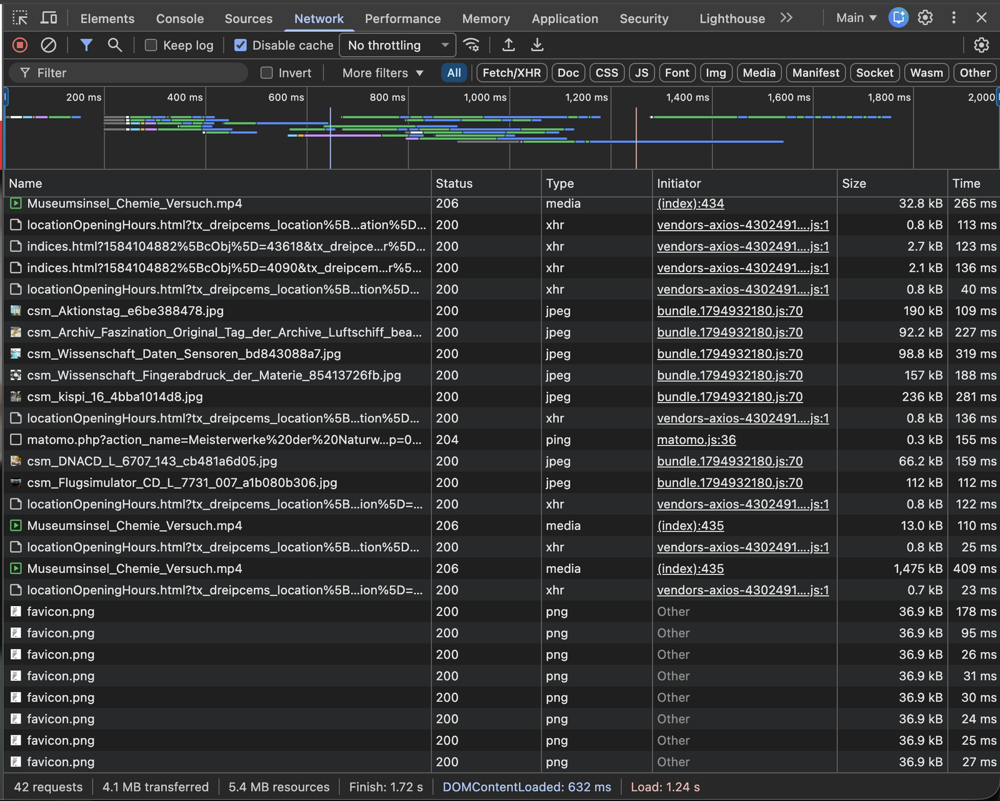

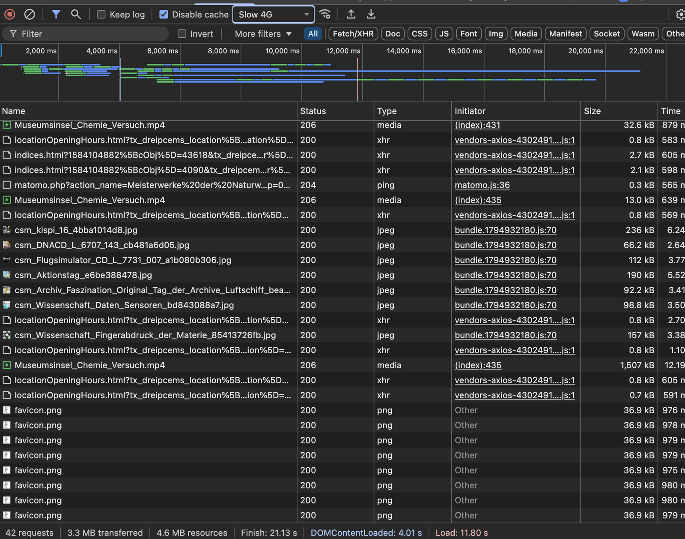

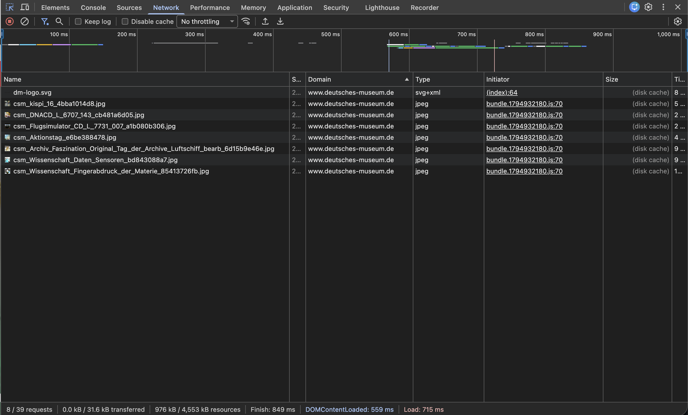

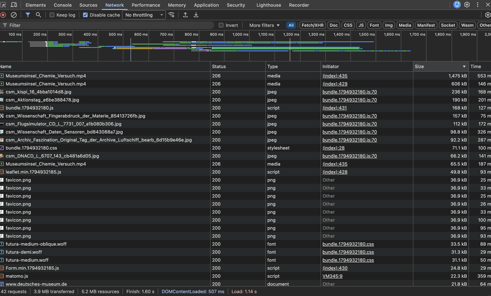

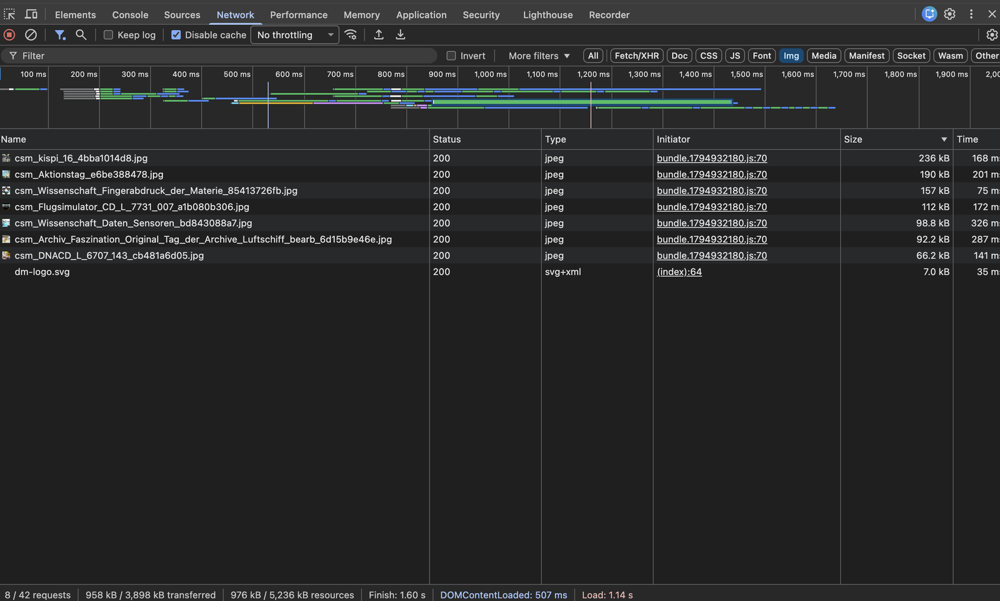

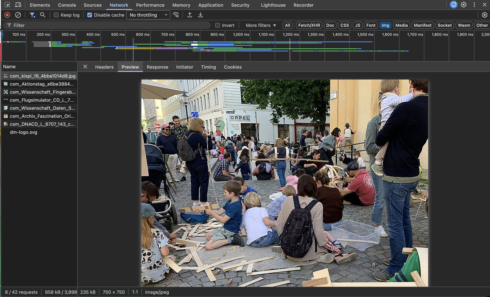

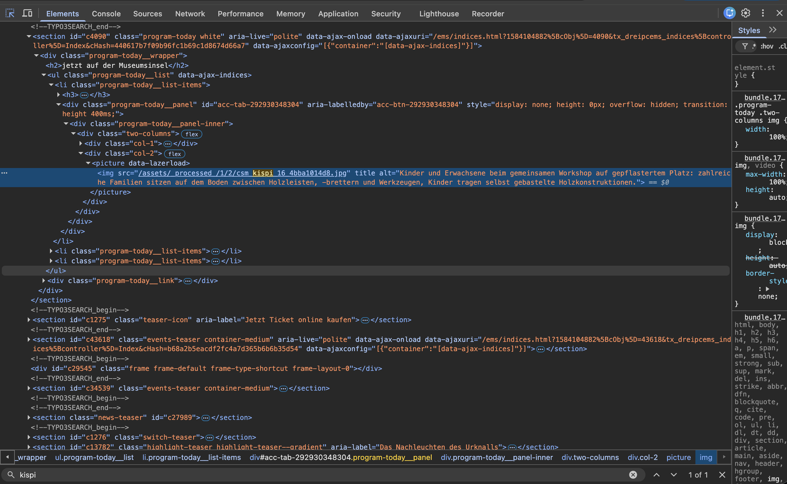

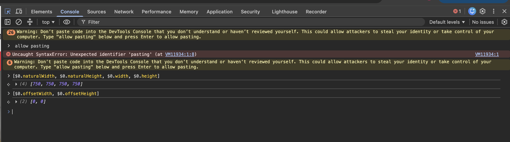

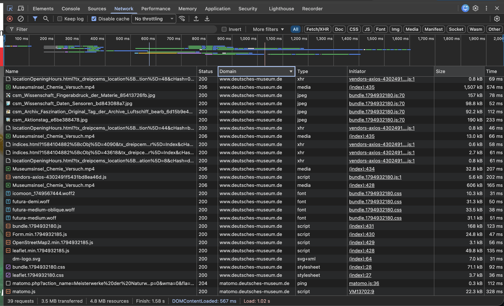

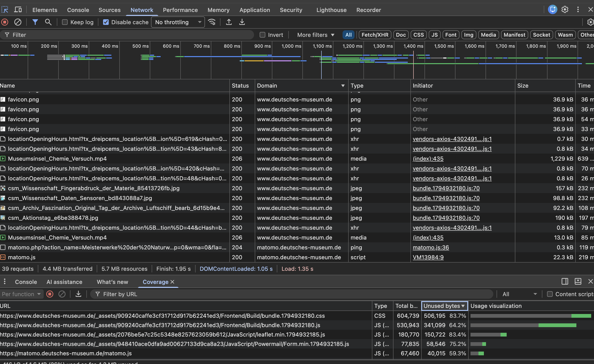

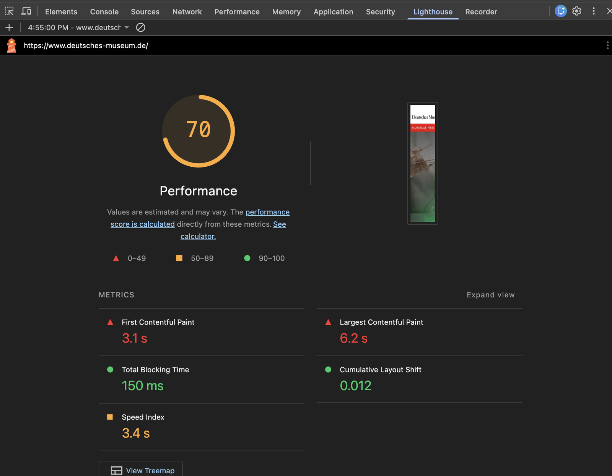

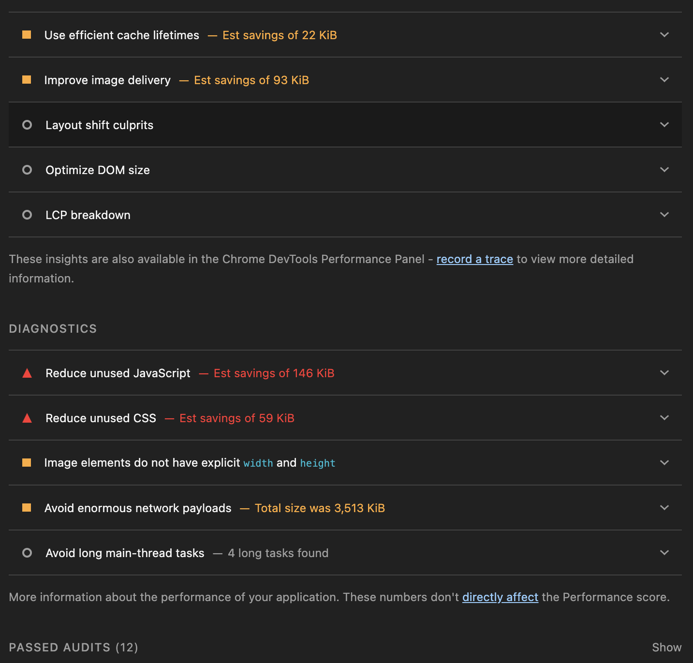

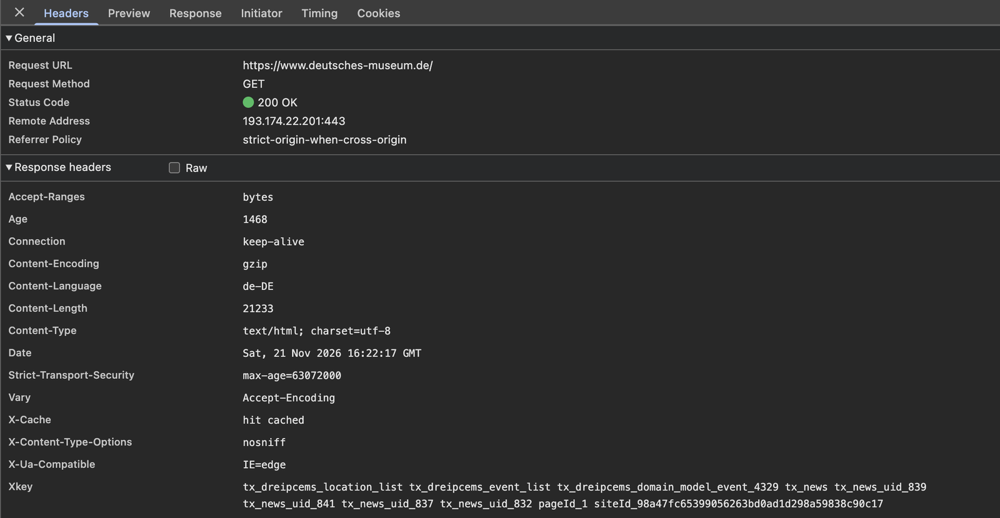

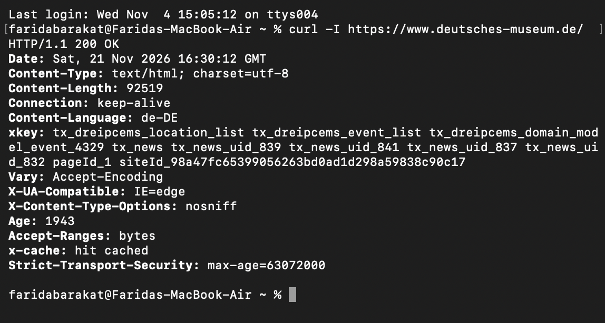
